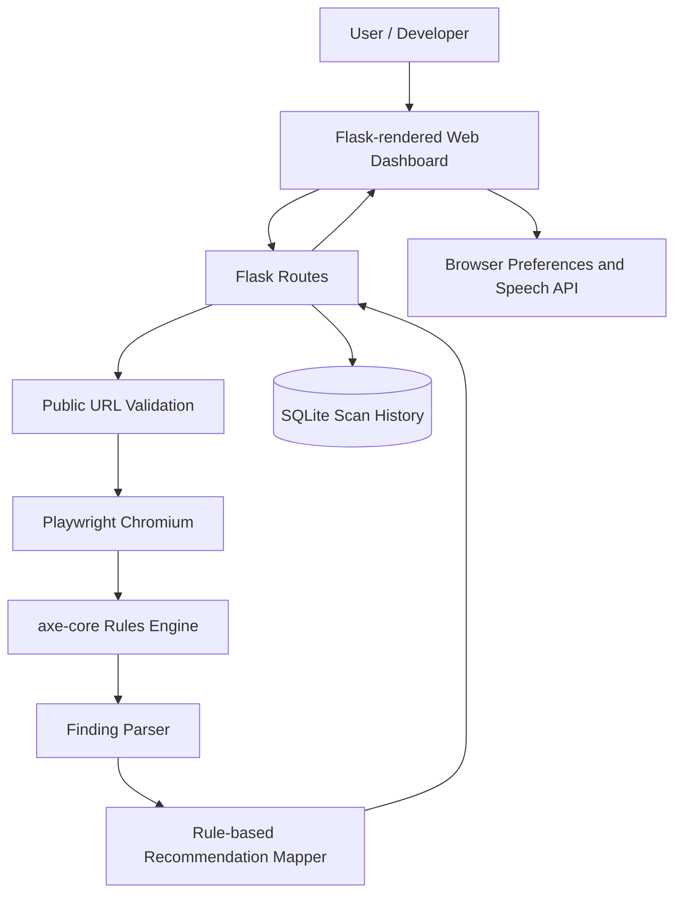

# AccessiAI — Technical Architecture

## Component flow

## Data model

`Scan`
- `id`: integer primary key
- `target_url`: scanned page URL
- `score`: illustrative indicator only; not a WCAG score
- `violation_count`: sum of affected node instances reported by axe-core
- `summary_json`: serialized finding summaries and recommendations
- `created_at`: UTC timestamp

## Main endpoints

| Method | Path | Purpose |
|---|---|---|
| GET | `/` | Dashboard and recent scan history |
| GET | `/health` | Deployment health check |
| GET | `/api/history` | Latest 20 scan records as JSON |
| POST | `/api/scan` | Scan a permitted public webpage |

## Security and operational notes
The prototype rejects non-HTTP(S), credential-bearing and non-public destinations. Browser requests are intercepted and destinations are checked again, including redirects and subresources. This reduces SSRF exposure but is not a substitute for production network isolation. A production service must add rate limits, quotas, request-size controls, monitoring and an explicit acceptable-use policy.
